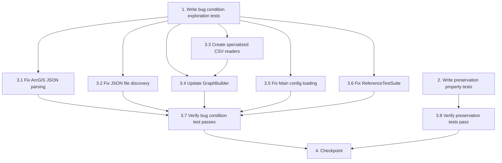

# Implementation Plan

## Overview

This task list implements the data loading bugfix using the exploratory bugfix workflow:
1. **Explore** - Write tests BEFORE fix to understand the bugs (Bug Condition)
2. **Preserve** - Write tests for non-buggy behavior (Preservation Requirements)
3. **Implement** - Apply fixes with understanding (Expected Behavior)
4. **Validate** - Verify fixes work and don't break anything

## Task Dependency Graph

```json
{
  "waves": [
    {
      "name": "Wave 1: Exploration and Preservation Testing",
      "tasks": ["1", "2"]
    },
    {
      "name": "Wave 2: Core Fixes",
      "tasks": ["3.1", "3.2", "3.3", "3.5", "3.6"]
    },
    {
      "name": "Wave 3: GraphBuilder Update",
      "tasks": ["3.4"]
    },
    {
      "name": "Wave 4: Verification",
      "tasks": ["3.7", "3.8"]
    },
    {
      "name": "Wave 5: Integration Checkpoint",
      "tasks": ["4"]
    }
  ]
}
```



**Execution Order**:
1. **Wave 1**: Tasks 1 and 2 run in parallel on unfixed code to establish bug conditions and preservation requirements
2. **Wave 2**: Tasks 3.1, 3.2, 3.3, 3.5, 3.6 can be done in parallel after task 1 completes
3. **Wave 3**: Task 3.4 depends on 3.3 (needs the specialized readers to be implemented first)
4. **Wave 4**: Task 3.7 depends on all fixes (3.1-3.6), task 3.8 depends on task 2 and all fixes
5. **Wave 5**: Task 4 depends on both 3.7 and 3.8 passing

## Tasks

- [x] 1. Write bug condition exploration tests
  - **Property 1: Bug Condition** - Data Loading From Raw Transit Files
  - **CRITICAL**: These tests MUST FAIL on unfixed code - failures confirm the bugs exist
  - **DO NOT attempt to fix the tests or the code when they fail**
  - **NOTE**: These tests encode the expected behavior - they will validate the fixes when they pass after implementation
  - **GOAL**: Surface counterexamples that demonstrate the 6 bugs exist
  - Create test class `src/test/java/co/medellin/transit/data/DataLoadingBugConditionTest.java`
  - Test 1.1 - CSV Schema Mismatch: Create `bus_segments.csv` with raw transit schema (route_id, direction, from_stop_id, to_stop_id, from_seq, to_seq, straight_m, road_m, used_m, method), attempt to read with GraphCsvReader, expect IllegalArgumentException "Missing source ID field"
  - Test 1.2 - JSON Location Mismatch: Place `stops_0.json` in `test-data/raw/` subdirectory, call ArcGisReader.readPaginated("stops", ".json"), expect warning "No paginated files found" and empty result list
  - Test 1.3 - Nested Geometry Parsing: Create JSON feature with nested geometry `{"attributes":{"OBJECTID":1},"geometry":{"x":-75.567,"y":6.234}}`, parse with StopArcGisReader, expect coordinates to be (0.0, 0.0) indicating geometry was excluded
  - Test 1.4 - Config Property Ignored: Create config.properties with `data.directory=test-data-dir`, invoke Main.main(new String[0]) without arguments, expect error message containing "No se encontró el directorio de datos: data" (using hardcoded path instead of config)
  - Test 1.5 - Test Suite Not Discovered: Run `mvn test` and verify ReferenceTestSuite class is not in execution report (name doesn't match `*Test` pattern)
  - Test 1.6 - Incomplete Test Execution: Manually invoke ReferenceTestSuite.testReferenceRoutingScenarios(), verify it only processes 5 test cases and doesn't assert results
  - Run tests on UNFIXED code
  - **EXPECTED OUTCOME**: All 6 tests FAIL (this is correct - it proves the bugs exist)
  - Document counterexamples found to understand root causes
  - Mark task complete when tests are written, run, and failures are documented
  - _Requirements: 1.1, 1.2, 1.3, 1.4, 1.5, 1.6_

- [x] 2. Write preservation property tests (BEFORE implementing fixes)
  - **Property 2: Preservation** - Pre-Computed Data Compatibility
  - **IMPORTANT**: Follow observation-first methodology
  - Observe behavior on UNFIXED code for non-buggy inputs (pre-computed data formats)
  - Write property-based tests capturing observed behavior patterns from Preservation Requirements
  - Property-based testing generates many test cases for stronger guarantees
  - Create test class `src/test/java/co/medellin/transit/data/PreservationTest.java`
  - Test 2.1 - Pre-Computed CSV Format: Create CSV with edge schema (source_id, target_id, edge_kind, real_sec, perceived_cost), read with GraphCsvReader on UNFIXED code, observe it parses successfully, write property-based test asserting GraphCsvReader continues to parse this format correctly
  - Test 2.2 - Simple JSON Geometry: Create JSON with flat geometry (no nested objects), parse with StopArcGisReader on UNFIXED code, observe coordinates are extracted correctly, write property-based test asserting coordinates remain correct after fix
  - Test 2.3 - Command-Line Data Directory: Invoke Main.main(new String[]{"custom-data-dir"}) on UNFIXED code, observe it uses the argument path, write property-based test asserting command-line argument continues to take precedence
  - Test 2.4 - Existing Unit Test Expectations: Run ArcGisReaderTest (2 failing tests) and StopArcGisReaderTest (5 failing tests) on UNFIXED code, document current failures (nested geometry causes coordinate loss), ensure test assertions remain unchanged - only fix code, not tests
  - Test 2.5 - Routing Algorithm Preservation: Load graph, run sample routing queries on UNFIXED code, observe Dijkstra produces specific paths, write property-based test asserting routing logic produces identical paths after fix (only graph construction changes, not routing)
  - Run tests on UNFIXED code
  - **EXPECTED OUTCOME**: Tests PASS on unfixed code for non-buggy inputs (confirms baseline behavior to preserve)
  - Mark task complete when tests are written, run, and passing on unfixed code
  - _Requirements: 3.1, 3.2, 3.3, 3.4, 3.5, 3.6_

- [x] 3. Fix data loading issues

  - [x] 3.1 Fix ArcGIS JSON parsing for nested geometry
    - Replace greedy regex `\{[^}]*"attributes"[^}]*\}` with brace counting algorithm
    - Implement `extractFeatureObjects(String featuresSection)` method in ArcGisReader
    - Use stack-based brace counting to find complete feature objects including nested geometry
    - Handle string literals (skip braces inside quoted strings)
    - Update `read()` method to use `extractFeatureObjects()` instead of `FEATURE_PATTERN.matcher()`
    - Add proper error handling for malformed JSON features
    - _Bug_Condition: isBugCondition(input) where jsonHasNestedGeometry(jsonFiles) AND regexCutsAtFirstBrace()_
    - _Expected_Behavior: System SHALL correctly extract both attributes and nested geometry objects, preserving coordinate data (Requirement 2.3)_
    - _Preservation: Simple JSON features without nested geometry SHALL continue to parse correctly (Requirement 3.2)_
    - _Requirements: 2.3, 3.2_

  - [x] 3.2 Fix JSON file discovery for paginated files
    - Update `readPaginated()` method in ArcGisReader to check for `data/raw/` subdirectory first
    - Add support for offset-based naming pattern (stops_0.json, stops_2000.json, ...) using regex `baseFilename_\d+extension`
    - Use `Files.list().filter().sorted()` to find all matching files
    - Fall back to old page-based naming (stops_1.json, stops_2.json, ...) if offset-based files not found
    - Add logging to show which directory and naming pattern is used
    - _Bug_Condition: isBugCondition(input) where jsonFilesInRawSubdirectory(jsonFiles) AND readerLooksInWrongLocation()_
    - _Expected_Behavior: System SHALL correctly locate and parse JSON files in data/raw/ subdirectory with offset-based naming (Requirement 2.2)_
    - _Preservation: Existing page-based naming in base directory SHALL continue to work (Requirement 3.1)_
    - _Requirements: 2.2, 3.1_

  - [x] 3.3 Create specialized CSV readers for raw transit data
    - Create `BusSegmentReader.java` extending `CsvReader<BusSegment>`
    - Implement parsing for schema: route_id, direction, from_stop_id, to_stop_id, from_seq, to_seq, straight_m, road_m, used_m, method
    - Create `BusSegment` record: routeId (String), direction (int), fromStopId (int), toStopId (int), fromSeq (int), toSeq (int), straightM (double), roadM (double), usedM (double), method (String)
    - Add validation: routeId not empty, direction in {0,1}, stop IDs ≥ 0, sequence numbers ≥ 0, distances > 0
    - Create `TransitLineReader.java` extending `CsvReader<TransitSegment>`
    - Implement parsing for schema: line, mode, order, station, lat, lon, dist_to_next_m, sec_to_next
    - Create `TransitSegment` record: line (String), mode (String), order (int), station (String), coordinate (Coordinate), distToNextM (double), secToNext (int)
    - Add validation: line not empty, mode in {Metro, Metroplus, Tranvía, Metrocable}, order ≥ 0, station not empty, coordinates in Medellín bounds (6.15-6.35N, -75.65--75.50W), distances ≥ 0, time ≥ 0
    - Create `WalkLinkReader.java` extending `CsvReader<WalkLink>`
    - Implement parsing for schema: place_a, name_a, place_b, name_b, kind, straight_m, walk_sec
    - Create `WalkLink` record: placeA (int), nameA (String), placeB (int), nameB (String), kind (String), straightM (double), walkSec (int)
    - Add validation: place IDs ≥ 0, names not empty, kind in {stop-to-stop, stop-to-station, station-to-station}, distance > 0, walkSec > 0
    - Write unit tests for each reader with valid and invalid data
    - _Bug_Condition: isBugCondition(input) where csvFilesMatchRawTransitSchema(csvFiles) AND NOT csvFilesMatchPrecomputedSchema(csvFiles)_
    - _Expected_Behavior: System SHALL parse raw transit CSV files and extract structured data (part of Requirement 2.1)_
    - _Preservation: Pre-computed edge CSV format SHALL continue to work (Requirement 3.1)_
    - _Requirements: 2.1, 3.1_

  - [x] 3.4 Update GraphBuilder to construct graph from raw transit data
    - Load configuration properties at start of build() method using Parameters class
    - Extract values: walkSpeedMps (1.25), walkStreetFactor (1.3), walkPenaltyMultiplier (1.5), walkPenaltyConstant (30), boardingPenaltySec (120)
    - Replace GraphCsvReader with specialized readers: BusSegmentReader, TransitLineReader, WalkLinkReader
    - Read raw data files: bus_segments.csv, transit_lines.csv, walk_links.csv
    - Build state lookup maps: stopIdToWalkStateId, stopRouteToStateId, stationLineToStateId
    - Assign WALK state IDs for all stops first
    - Generate RIDE edges from bus segments: calculate travel time as (usedM / busSpeedMps) + dwellTimeSec, perceivedCost = realSec (no penalty)
    - Generate RIDE edges from transit lines: use secToNext directly from data, perceivedCost = realSec
    - Generate BOARD edges: WALK -> BUS_STOP/METRO_STATION with waitTime + boardingPenalty (120s)
    - Generate ALIGHT edges: BUS_STOP/METRO_STATION -> WALK with 0 perceived cost
    - Generate WALK edges from walk links: calculate realSec from (straightM × walkStreetFactor) / walkSpeedMps or use walkSec if available, apply penalty (realSec × walkPenaltyMultiplier + walkPenaltyConstant), add bidirectional edges
    - Add helper method getBusSpeed(routeId, params) to look up speed by route type
    - Verify graph dimensions: ~13,895 states, ~82,160 edges as per docs/graph-structure.md
    - Write integration test with minimal test data files
    - _Bug_Condition: isBugCondition(input) where csvFilesMatchRawTransitSchema(csvFiles)_
    - _Expected_Behavior: System SHALL construct graph edges following graph-structure.md specification with speeds, waits, and penalties from config.properties (Requirement 2.1)_
    - _Preservation: Routing algorithm SHALL remain unchanged (Requirement 3.5)_
    - _Requirements: 2.1, 2.6, 3.5_

  - [x] 3.5 Fix Main configuration loading
    - Add imports: java.io.InputStream, java.util.Properties
    - In main() method after configureLogging(), check if args.length > 0
    - If command-line argument present: use args[0] as dataDirPath (precedence preserved)
    - If no argument: load config.properties using ClassLoader.getResourceAsStream()
    - Read data.directory property, default to DEFAULT_DATA_DIR if not found or IOException occurs
    - Add logging for each case: "Using data directory from command-line", "Using data directory from config.properties", "config.properties not found"
    - Test with no arguments and config.properties present
    - Test with command-line argument (should take precedence)
    - Test with missing config.properties (should fall back to default)
    - _Bug_Condition: isBugCondition(input) where configPropsHasDataDirectory(configProps) AND mainUsesHardcodedPath()_
    - _Expected_Behavior: System SHALL read data.directory property from config.properties when no command-line argument provided (Requirement 2.4)_
    - _Preservation: Command-line argument SHALL continue to take precedence (Requirement 3.3)_
    - _Requirements: 2.4, 3.3_

  - [x] 3.6 Fix ReferenceTestSuite execution and assertions
    - Rename file from ReferenceTestSuite.java to ReferenceTest.java
    - Rename class from ReferenceTestSuite to ReferenceTest (Maven Surefire will discover *Test classes)
    - Remove testCount and maxTests variables from testReferenceRoutingScenarios()
    - Remove if (testCount++ >= maxTests) break; condition to process ALL test cases
    - Create assertRouteMatches(Trip trip, TestCase expected) method with 4 assertions:
    - Assert travel time: assertEquals(expected.expectedMinutes(), trip.getTotalTime() / 60, 2) with ±2 minute tolerance
    - Assert cost: assertEquals(expected.expectedCost(), trip.getFare(), 100) with ±100 COP tolerance
    - Assert transfers: assertEquals(expected.expectedTransfers(), trip.getTransfers()) exact match
    - Assert vehicle sequence: assertEquals(expected.expectedVehicles(), trip.getSteps().stream().filter(RIDE).map(routeName).join(",")) exact match
    - Call assertRouteMatches() for each test case result
    - Run mvn test to verify ReferenceTest is discovered and all 15 cases execute
    - _Bug_Condition: isBugCondition(input) where testInvocationTargetsReferenceTestSuite() AND classNameMismatchesMavenPattern()_
    - _Expected_Behavior: System SHALL run ReferenceTest, process all 15 test cases, and assert results match expected values (Requirement 2.5)_
    - _Preservation: test_cases.csv expected values SHALL remain unchanged (Requirement 3.6)_
    - _Requirements: 2.5, 3.6_

  - [x] 3.7 Verify bug condition exploration test now passes
    - **Property 1: Expected Behavior** - Data Loading From Raw Transit Files
    - **IMPORTANT**: Re-run the SAME tests from task 1 - do NOT write new tests
    - The tests from task 1 encode the expected behavior
    - When these tests pass, it confirms the expected behavior is satisfied
    - Run DataLoadingBugConditionTest from task 1
    - Verify Test 1.1 now successfully reads CSV with raw transit schema and constructs graph
    - Verify Test 1.2 now finds JSON files in data/raw/ subdirectory with offset-based naming
    - Verify Test 1.3 now extracts coordinates correctly from nested geometry JSON
    - Verify Test 1.4 now reads data.directory from config.properties when no command-line argument provided
    - Verify Test 1.5 shows ReferenceTest is discovered by Maven (mvn test execution report)
    - Verify Test 1.6 shows ReferenceTest processes all 15 cases and asserts results
    - **EXPECTED OUTCOME**: All 6 tests PASS (confirms bugs are fixed)
    - _Requirements: 2.1, 2.2, 2.3, 2.4, 2.5, 2.6, 2.7_

  - [x] 3.8 Verify preservation tests still pass
    - **Property 2: Preservation** - Pre-Computed Data Compatibility
    - **IMPORTANT**: Re-run the SAME tests from task 2 - do NOT write new tests
    - Run PreservationTest from task 2
    - Verify Test 2.1 still successfully parses pre-computed CSV with edge schema
    - Verify Test 2.2 still correctly extracts coordinates from simple JSON geometry
    - Verify Test 2.3 still uses command-line argument when provided (precedence preserved)
    - Verify Test 2.4 shows ArcGisReaderTest and StopArcGisReaderTest now pass (7 previously failing tests now pass without changing test expectations)
    - Verify Test 2.5 shows routing queries produce identical paths (only graph construction changed)
    - **EXPECTED OUTCOME**: All preservation tests PASS (confirms no regressions)
    - _Requirements: 3.1, 3.2, 3.3, 3.4, 3.5, 3.6_

- [x] 4. Checkpoint - Ensure all tests pass and verify integration
  - Run complete Maven test suite: `mvn test`
  - Verify 0 failures, 0 errors (previously had 7 failures, 1 error)
  - Verify all 15 reference test cases execute and pass
  - Verify ArcGisReaderTest passes (2 previously failing tests)
  - Verify StopArcGisReaderTest passes (5 previously failing tests)
  - Run Main with no arguments and actual data files
  - Verify graph loads successfully with ~13,895 states and ~82,160 edges
  - Verify home screen displays (not "El grafo está vacío")
  - Verify no error message "No se encontró el directorio de datos"
  - Run sample routing query from home screen to ensure end-to-end functionality
  - Document any questions or issues that arise
  - _Requirements: 2.6, 2.7_


## Notes

### Testing Strategy

This bugfix follows the exploratory bugfix workflow:
1. **Exploration (Tasks 1)**: Write tests that fail on unfixed code to understand and document the bugs
2. **Preservation (Task 2)**: Write tests that pass on unfixed code to prevent regressions
3. **Implementation (Tasks 3.1-3.6)**: Apply fixes based on understanding from exploration
4. **Verification (Tasks 3.7-3.8)**: Confirm fixes work and preserve existing behavior

### Key Implementation Notes

- **Task 1 is critical**: These tests MUST fail initially. If they pass, the bug analysis is wrong.
- **Task 2 captures baseline**: Tests must pass on unfixed code to establish what to preserve.
- **GraphBuilder changes are extensive**: Task 3.4 involves substantial refactoring to transform raw transit data into graph edges.
- **ArcGIS parsing fix is subtle**: The brace counting algorithm must handle string literals to avoid counting braces inside quoted strings.
- **Maven test count**: Before fix = 332 tests with 7 failures + 1 error. After fix = 347 tests (adds 15 reference cases) with 0 failures + 0 errors.

### Expected Outcomes

- Graph construction from raw data: ~13,895 states, ~82,160 edges
- All 15 reference test cases execute and pass
- 7 previously failing unit tests (ArcGisReaderTest + StopArcGisReaderTest) now pass
- Home screen displays successfully when running Main with no arguments
- Pre-computed data formats continue to work (backward compatibility)

### Reference Documents

- **Bug Condition Methodology**: See design.md sections on Bug Condition (C), Property (P), Preservation (¬C)
- **Graph Structure Specification**: See docs/graph-structure.md for edge types, state types, and expected dimensions
- **Configuration Properties**: See config.properties for routing parameters (speeds, penalties, wait times)
- **Test Cases**: See test_cases.csv for 15 reference routing scenarios with expected results
