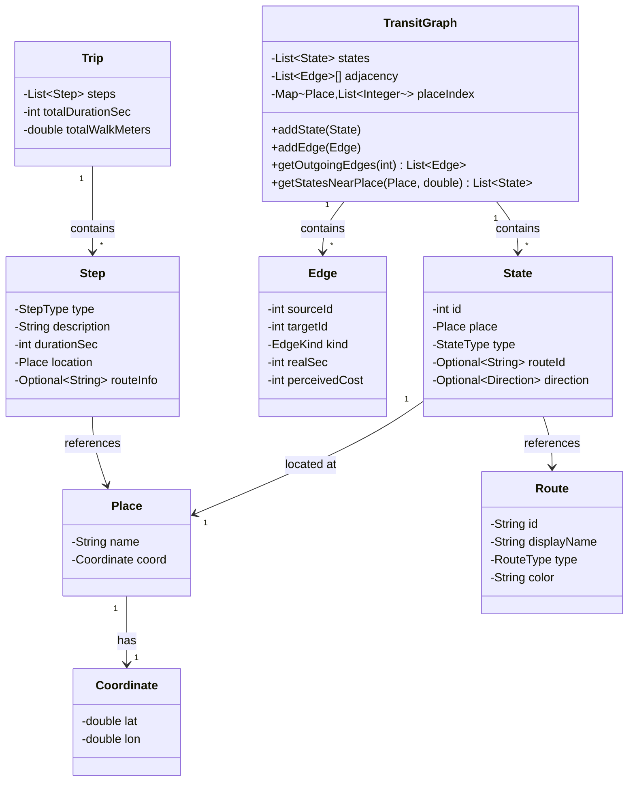

# Design Document: Medellín Transit Routing System

## Overview

The Medellín Transit Routing System is a Java console application that provides offline multi-modal transit routing for Medellín's public transportation network. The system computes optimal routes combining walking and public transit (buses and metro) using a multi-source/multi-target Dijkstra algorithm on a pre-computed graph representation.

### Key Design Goals

1. **Performance**: Data loading in under 1 second, route queries in under 100 milliseconds
2. **Offline Operation**: All data pre-loaded from CSV files, no external API dependencies
3. **User Experience**: Spanish-language console interface with clear, actionable routing instructions
4. **Accuracy**: Faithful implementation of validated Python prototype algorithm
5. **Maintainability**: Clean separation of concerns with well-defined component boundaries

### System Constraints

- **Graph Size**: 13,895 states (nodes), 82,160 edges
- **Memory Footprint**: Entire graph must fit in heap memory
- **Data Format**: CSV files for stops, routes, metro stations, and graph topology
- **Address System**: Medellín street naming convention (e.g., "Carrera 43A # 1 Sur - 100")
- **Access Radius**: 500 meters walking distance from origin/destination
- **Integration Window**: 90 minutes for fare calculation

## Architecture

### High-Level Architecture

The system follows a layered architecture with clear separation between data loading, graph construction, routing computation, and user interface:

```
┌─────────────────────────────────────────────────────────────┐
│                      User Interface Layer                    │
│  (HomeScreen, Menu, TripPrinter - Spanish language output)  │
└────────────────────────┬────────────────────────────────────┘
                         │
┌────────────────────────┴────────────────────────────────────┐
│                    Application Layer                         │
│  (Orchestrates routing workflow, coordinates components)     │
└─────┬──────────┬──────────┬──────────┬─────────────────────┘
      │          │          │          │
      ▼          ▼          ▼          ▼
┌─────────┐ ┌─────────┐ ┌────────┐ ┌──────────────┐
│Geocoding│ │ Routing │ │ Fares  │ │ Step Builder │
│ Module  │ │ Module  │ │ Module │ │              │
└────┬────┘ └────┬────┘ └────┬───┘ └──────┬───────┘
     │           │           │            │
     └───────────┴───────────┴────────────┘
                      │
         ┌────────────┴───────────────┐
         │      Graph & Data Layer    │
         │  (GraphBuilder, CSV data)  │
         └────────────────────────────┘
```

### Component Overview

1. **Data Layer**: Loads CSV files and provides domain models (Place, Route, State, Edge)
2. **Graph Layer**: Constructs in-memory graph representation optimized for Dijkstra's algorithm
3. **Geocoding Layer**: Parses addresses and converts them to geographic coordinates
4. **Routing Layer**: Implements multi-source/multi-target Dijkstra algorithm
5. **Fares Layer**: Calculates transit fares with integration rules
6. **Step Builder Layer**: Converts routing solution to human-readable instructions
7. **UI Layer**: Console-based interaction with Spanish-language prompts

### Threading Model

The application is **single-threaded** with the following rationale:

- Graph construction happens once at startup (< 1 second)
- Individual route queries are fast (< 100ms) and sequential
- No concurrent user requests (console application)
- Simplifies debugging and maintains deterministic behavior

Future enhancement: Multi-threaded data loading could reduce startup time, but current performance meets requirements.

## Components and Interfaces

### 1. GraphBuilder

**Responsibility**: Constructs the transit graph from CSV data files.

**Key Methods**:
```java
public class GraphBuilder {
    /**
     * Builds complete transit graph from CSV files
     * @param dataDir directory containing CSV files
     * @return TransitGraph ready for routing
     * @throws IOException if file reading fails
     */
    public TransitGraph build(Path dataDir) throws IOException;
    
    /**
     * Internal: Creates walking edges between nearby stops
     * @param states all states in graph
     * @param maxWalkMeters maximum walking distance
     */
    private void addWalkingEdges(List<State> states, double maxWalkMeters);
    
    /**
     * Internal: Adds board/alight edges for route stops
     * @param route route metadata
     * @param stops ordered list of stops
     */
    private void addTransitEdges(Route route, List<Stop> stops);
}
```

**Dependencies**:
- `CsvReader`: Reads CSV files into domain objects
- `ArcGisReader`: Reads ArcGIS-format geometry data
- `Geo`: Geographic distance calculations

**Algorithm**:
1. Load stops, routes, and metro stations from CSV
2. Create state nodes: (place, WALK), (STOP:id, route, dir), (STATION:name, line, dir)
3. Add ride edges within each route/line based on travel times
4. Add board edges: (place, WALK) → (STOP/STATION, route/line, dir) with cost = 0
5. Add alight edges: (STOP/STATION, route/line, dir) → (place, WALK) with cost = travel time
6. Add walking edges between states within 500m radius
7. Build adjacency list representation for efficient Dijkstra traversal

**Data Structures**:
```java
public class TransitGraph {
    private final List<State> states;           // All nodes in graph
    private final List<Edge>[] adjacency;       // adjacency[stateId] = outgoing edges
    private final Map<Place, List<State>> placeIndex;  // Quick lookup by place
    
    public List<Edge> getOutgoingEdges(int stateId);
    public List<State> getStatesNearPlace(Place place, double radiusMeters);
}
```

**Performance Considerations**:
- Pre-compute all edges during construction (no runtime edge generation)
- Use primitive int arrays for adjacency list to minimize object overhead
- Index states by place for fast origin/destination lookup

### 2. AddressParser

**Responsibility**: Parses Medellín street addresses into structured components.

**Key Methods**:
```java
public class AddressParser {
    /**
     * Parses Medellín address string
     * @param addressStr e.g., "Carrera 43A # 1 Sur - 100"
     * @return ParsedAddress or empty if invalid format
     */
    public Optional<ParsedAddress> parse(String addressStr);
}

public class ParsedAddress {
    private final StreetType type;      // CALLE, CARRERA, DIAGONAL, CIRCULAR, TRANSVERSAL
    private final String primary;       // e.g., "43A"
    private final String secondary;     // e.g., "1 Sur"
    private final String number;        // e.g., "100"
    private final Cardinal cardinal;    // Optional: NORTE, SUR, ESTE, OESTE
}
```

**Parsing Rules**:
1. Primary street identifier: `(Calle|Carrera|Diagonal|Circular|Transversal) <number>[A-Z]?`
2. Secondary identifier after `#`: `<number> (Sur|Norte)?`
3. Building number after `-`: `<number>`
4. Cardinal directions: `Norte`, `Sur`, `Este`, `Oeste` (case-insensitive)

**Error Handling**:
- Returns `Optional.empty()` for malformed addresses
- Caller displays Spanish error message: "Formato de dirección inválido"

### 3. AddressLocator

**Responsibility**: Converts parsed addresses to geographic coordinates.

**Key Methods**:
```java
public class AddressLocator {
    /**
     * Converts parsed address to geographic coordinates
     * @param address parsed address components
     * @return Coordinate or empty if cannot locate
     */
    public Optional<Coordinate> locate(ParsedAddress address);
    
    /**
     * Checks if coordinate is within Medellín bounds
     * @param coord coordinate to check
     * @return true if within city bounds
     */
    public boolean isInBounds(Coordinate coord);
}
```

**Algorithm** (Simplified Grid Interpolation):
1. Medellín uses a grid system with numbered streets
2. Use reference points for major streets (from CSV or hardcoded)
3. Interpolate between reference points for intermediate addresses
4. Validate result is within Medellín boundary box
5. Return coordinate or empty if extrapolation is unreliable

**Bounds**:
- North: ~6.35° latitude
- South: ~6.15° latitude
- East: ~-75.50° longitude
- West: ~-75.65° longitude

### 4. Router

**Responsibility**: Computes optimal transit routes using multi-source/multi-target Dijkstra.

**Key Methods**:
```java
public class Router {
    private final TransitGraph graph;
    
    /**
     * Finds optimal route from origin to destination
     * @param origin starting place (from geocoding)
     * @param destination ending place
     * @param params routing parameters (access radius, penalties)
     * @return Optional<RoutingResult> containing path and metadata
     */
    public Optional<RoutingResult> findRoute(
        Place origin, 
        Place destination, 
        Parameters params
    );
    
    /**
     * Internal: Multi-source/multi-target Dijkstra
     * @param sources starting states (within access radius of origin)
     * @param targets destination states (within access radius of destination)
     * @return best path or empty
     */
    private Optional<DijkstraResult> dijkstra(
        List<State> sources, 
        List<State> targets
    );
}
```

**Algorithm** (Multi-source/multi-target Dijkstra):

```
function findRoute(origin, destination, params):
    // Phase 1: Find accessible states
    sourceStates = graph.getStatesNearPlace(origin, params.accessRadius)
    targetStates = graph.getStatesNearPlace(destination, params.accessRadius)
    
    if sourceStates.isEmpty() or targetStates.isEmpty():
        return empty  // No stops within radius
    
    // Phase 2: Multi-source Dijkstra
    result = dijkstra(sourceStates, targetStates)
    
    return result

function dijkstra(sources, targets):
    // Initialize
    distances = array[graph.size] filled with INFINITY
    previous = array[graph.size] filled with NULL
    pq = MinPriorityQueue()
    targetSet = set(targets)
    
    // Add all sources with cost 0
    for each source in sources:
        distances[source.id] = 0
        pq.add(source.id, 0)
    
    bestTargetCost = INFINITY
    bestTarget = NULL
    
    while not pq.isEmpty():
        current = pq.extractMin()
        currentCost = distances[current]
        
        // Early termination: found optimal target
        if current in targetSet:
            if currentCost < bestTargetCost:
                bestTargetCost = currentCost
                bestTarget = current
            // Continue until pq.min > bestTargetCost for optimality
            if pq.peekMin() > bestTargetCost:
                break
        
        // Relax outgoing edges
        for each edge in graph.getOutgoingEdges(current):
            neighbor = edge.target
            newCost = currentCost + edge.perceivedCost
            
            if newCost < distances[neighbor]:
                distances[neighbor] = newCost
                previous[neighbor] = current
                pq.add(neighbor, newCost)
    
    if bestTarget == NULL:
        return empty  // No path exists
    
    // Reconstruct path
    path = []
    node = bestTarget
    while node != NULL:
        path.prepend(node)
        node = previous[node]
    
    return DijkstraResult(path, bestTargetCost)
```

**Cost Function**:
- **Perceived cost** (for routing optimization): `realSec + penalties`
- **Real cost** (for display): `realSec` (no penalties)
- **Boarding penalty**: +120 seconds per boarding action
- **Walking penalty**: `walkTime * 1.5 + 30` seconds per walking edge

**Data Structures**:
```java
public class DijkstraResult {
    private final List<State> path;         // Ordered states from origin to destination
    private final double perceivedCost;     // Cost used for optimization
    private final double realDurationSec;   // Actual travel time (for display)
}
```

**Performance Optimizations**:
1. Use primitive int arrays for distances and previous pointers
2. Binary heap priority queue (java.util.PriorityQueue)
3. Early termination when optimal target found
4. Reuse distance/previous arrays across queries (clear between runs)

### 5. FareCalculator

**Responsibility**: Computes total fare based on route segments and integration rules.

**Key Methods**:
```java
public class FareCalculator {
    /**
     * Calculates total fare for trip
     * @param trip complete trip with segments
     * @return Fare breakdown
     */
    public FareResult calculate(Trip trip);
}

public class FareResult {
    private final int totalCOP;                    // Total in Colombian Pesos
    private final List<FareSegment> segments;      // Per-segment breakdown
    private final boolean integrationApplied;      // Whether discount applied
}
```

**Fare Rules** (as of design time - configurable):
1. **Metro**: Base fare
2. **Bus**: Separate fare per boarding
3. **Integration**: If metro → bus or bus → metro within 90 minutes, discounted second fare
4. **Walking**: Free

**Algorithm**:
```
function calculate(trip):
    segments = []
    lastBoardingTime = NULL
    lastMode = NULL
    totalFare = 0
    
    for each step in trip.steps:
        if step is boarding:
            boardingTime = step.time
            mode = step.mode  // METRO or BUS
            baseFare = getFareForMode(mode)
            
            // Check integration
            if lastBoardingTime != NULL and 
               (boardingTime - lastBoardingTime) <= 90 minutes and
               mode != lastMode:
                appliedFare = baseFare * integrationDiscount  // e.g., 0.5
                integrationApplied = true
            else:
                appliedFare = baseFare
                integrationApplied = false
            
            segments.add(FareSegment(mode, baseFare, appliedFare, integrationApplied))
            totalFare += appliedFare
            
            lastBoardingTime = boardingTime
            lastMode = mode
    
    return FareResult(totalFare, segments, integrationApplied)
```

**Configuration**:
```java
public class FareConfig {
    private final int metroFareCOP = 3000;
    private final int busFareCOP = 2950;
    private final double integrationDiscount = 0.5;
    private final int integrationWindowMinutes = 90;
}
```

### 6. StepBuilder

**Responsibility**: Converts Dijkstra path (sequence of states and edges) into human-readable trip instructions.

**Key Methods**:
```java
public class StepBuilder {
    /**
     * Builds user-facing trip instructions from routing result
     * @param dijkstraResult path from router
     * @param graph transit graph (for edge details)
     * @return Trip with ordered steps
     */
    public Trip buildTrip(DijkstraResult dijkstraResult, TransitGraph graph);
}

public class Trip {
    private final List<Step> steps;
    private final int totalDurationSec;
    private final double totalWalkMeters;
}

public class Step {
    private final StepType type;  // WALK, BOARD, RIDE, ALIGHT
    private final String description;
    private final int durationSec;
    private final Place location;
    private final Optional<String> routeInfo;  // e.g., "Línea A" or "Ruta 301"
}
```

**Algorithm**:
```
function buildTrip(dijkstraResult, graph):
    steps = []
    currentMode = WALK
    currentRoute = NULL
    rideStartTime = 0
    
    for i from 0 to dijkstraResult.path.length - 2:
        currentState = dijkstraResult.path[i]
        nextState = dijkstraResult.path[i + 1]
        edge = graph.getEdge(currentState, nextState)
        
        match edge.kind:
            case WALK:
                steps.add(Step(
                    type = WALK,
                    description = "Caminar a {nextState.place.name}",
                    durationSec = edge.realSec,
                    location = nextState.place
                ))
            
            case BOARD:
                steps.add(Step(
                    type = BOARD,
                    description = "Abordar {nextState.route} en {currentState.place.name}",
                    durationSec = 0,
                    location = currentState.place,
                    routeInfo = nextState.route
                ))
                currentMode = RIDE
                currentRoute = nextState.route
                rideStartTime = currentTime
            
            case RIDE:
                // Accumulate ride time, emit step when alighting
                currentTime += edge.realSec
            
            case ALIGHT:
                rideDuration = currentTime - rideStartTime
                steps.add(Step(
                    type = RIDE,
                    description = "Viajar en {currentRoute} por {rideDuration/60} minutos",
                    durationSec = rideDuration,
                    location = currentState.place,
                    routeInfo = currentRoute
                ))
                steps.add(Step(
                    type = ALIGHT,
                    description = "Bajar en {nextState.place.name}",
                    durationSec = edge.realSec,
                    location = nextState.place
                ))
                currentMode = WALK
                currentRoute = NULL
    
    return Trip(steps, totalDurationSec, totalWalkMeters)
```

**Step Consolidation**:
- Consecutive RIDE edges on same route → single "Viajar en..." step
- Short walks (< 50m) between stops of same route → omit
- Final walk to destination → "Caminar a destino"

### 7. UI Components

#### HomeScreen

**Responsibility**: Application entry point, displays welcome message and initializes menu.

```java
public class HomeScreen {
    public void display() {
        System.out.println("=================================");
        System.out.println(" Sistema de Rutas Medellín Metro");
        System.out.println("=================================");
        System.out.println();
    }
}
```

#### Menu

**Responsibility**: Handles user interaction loop.

```java
public class Menu {
    private final Scanner scanner;
    private final Router router;
    private final AddressParser addressParser;
    private final AddressLocator addressLocator;
    private final FareCalculator fareCalculator;
    private final TripPrinter tripPrinter;
    
    public void run() {
        while (true) {
            System.out.println("Ingrese la dirección de origen (o 'salir' para terminar):");
            String originStr = scanner.nextLine().trim();
            
            if (originStr.equalsIgnoreCase("salir")) {
                System.out.println("¡Hasta luego!");
                break;
            }
            
            Optional<Place> origin = geocode(originStr);
            if (origin.isEmpty()) continue;
            
            System.out.println("Ingrese la dirección de destino:");
            String destStr = scanner.nextLine().trim();
            
            Optional<Place> dest = geocode(destStr);
            if (dest.isEmpty()) continue;
            
            Optional<RoutingResult> result = router.findRoute(origin.get(), dest.get());
            
            if (result.isEmpty()) {
                System.out.println("No se encontró una ruta. Intente con direcciones diferentes.");
                continue;
            }
            
            Trip trip = stepBuilder.buildTrip(result.get());
            FareResult fare = fareCalculator.calculate(trip);
            
            tripPrinter.print(trip, fare);
        }
    }
    
    private Optional<Place> geocode(String addressStr) {
        Optional<ParsedAddress> parsed = addressParser.parse(addressStr);
        if (parsed.isEmpty()) {
            System.out.println("Error: Formato de dirección inválido.");
            System.out.println("Ejemplo: Carrera 43A # 1 Sur - 100");
            return Optional.empty();
        }
        
        Optional<Coordinate> coord = addressLocator.locate(parsed.get());
        if (coord.isEmpty()) {
            System.out.println("Error: No se pudo localizar la dirección.");
            return Optional.empty();
        }
        
        if (!addressLocator.isInBounds(coord.get())) {
            System.out.println("Error: La dirección está fuera de los límites de Medellín.");
            return Optional.empty();
        }
        
        return Optional.of(new Place(addressStr, coord.get()));
    }
}
```

#### TripPrinter

**Responsibility**: Formats and displays trip instructions.

```java
public class TripPrinter {
    public void print(Trip trip, FareResult fare) {
        System.out.println("\n==== RUTA ENCONTRADA ====\n");
        System.out.printf("Duración total: %d minutos\n", trip.totalDurationSec / 60);
        System.out.printf("Distancia a pie: %.0f metros\n", trip.totalWalkMeters);
        System.out.printf("Tarifa total: $%,d COP\n\n", fare.totalCOP);
        
        System.out.println("Instrucciones:");
        for (int i = 0; i < trip.steps.size(); i++) {
            Step step = trip.steps.get(i);
            System.out.printf("%d. %s", i + 1, step.description);
            if (step.durationSec > 0) {
                System.out.printf(" (%d min)", step.durationSec / 60);
            }
            System.out.println();
        }
        
        if (fare.integrationApplied) {
            System.out.println("\n✓ Descuento por integración aplicado");
        }
        
        System.out.println("\n=======================\n");
    }
}
```

## Data Models

### Core Domain Objects

```java
public class Place {
    private final String name;          // Display name (address or POI)
    private final Coordinate coord;     // Geographic location
}

public class Coordinate {
    private final double lat;           // Latitude (degrees)
    private final double lon;           // Longitude (degrees)
}

public class Route {
    private final String id;            // e.g., "301", "A"
    private final String displayName;   // e.g., "Ruta 301", "Línea A"
    private final RouteType type;       // BUS or METRO
    private final String color;         // Hex color for display
}

public enum RouteType {
    BUS,
    METRO
}

public class State {
    private final int id;               // Unique identifier (0 to n-1)
    private final Place place;          // Physical location
    private final StateType type;       // WALK, BUS_STOP, METRO_STATION
    private final Optional<String> routeId;      // Present if on a route
    private final Optional<Direction> direction; // Present if on a route
}

public enum StateType {
    WALK,           // (place, WALK)
    BUS_STOP,       // (STOP:id, route, dir)
    METRO_STATION   // (STATION:name, line, dir)
}

public enum Direction {
    OUTBOUND,  // Ida
    INBOUND    // Regreso
}

public class Edge {
    private final int sourceId;         // Source state ID
    private final int targetId;         // Target state ID
    private final EdgeKind kind;        // Type of edge
    private final int realSec;          // Actual travel time (seconds)
    private final int perceivedCost;    // Cost for routing (includes penalties)
}

public enum EdgeKind {
    WALK,      // Walking between locations
    BOARD,     // Getting on a vehicle
    RIDE,      // Traveling on a vehicle
    ALIGHT     // Getting off a vehicle
}
```

### Graph Representation

```java
public class TransitGraph {
    private final List<State> states;
    private final List<Edge>[] adjacency;  // adjacency[stateId] = list of outgoing edges
    private final Map<Place, List<Integer>> placeIndex;  // place -> state IDs
    
    public TransitGraph(int numStates) {
        this.states = new ArrayList<>(numStates);
        this.adjacency = new List[numStates];
        this.placeIndex = new HashMap<>();
        for (int i = 0; i < numStates; i++) {
            adjacency[i] = new ArrayList<>();
        }
    }
    
    public void addState(State state) {
        states.add(state);
        placeIndex.computeIfAbsent(state.place, k -> new ArrayList<>()).add(state.id);
    }
    
    public void addEdge(Edge edge) {
        adjacency[edge.sourceId].add(edge);
    }
    
    public List<Edge> getOutgoingEdges(int stateId) {
        return adjacency[stateId];
    }
    
    public List<State> getStatesNearPlace(Place place, double radiusMeters) {
        List<State> nearby = new ArrayList<>();
        for (State state : states) {
            if (Geo.distance(place.coord, state.place.coord) <= radiusMeters) {
                nearby.add(state);
            }
        }
        return nearby;
    }
}
```

### Class Diagram



## Error Handling

### Error Categories and Strategies

#### 1. Input Validation Errors

**Scenario**: User enters invalid address format

**Detection**: `AddressParser.parse()` returns `Optional.empty()`

**Handling**:
```java
if (parsed.isEmpty()) {
    System.out.println("Error: Formato de dirección inválido.");
    System.out.println("Ejemplo válido: Carrera 43A # 1 Sur - 100");
    return Optional.empty();
}
```

**User Experience**: Clear error message with example, prompt for re-entry

---

**Scenario**: Address out of Medellín bounds

**Detection**: `AddressLocator.isInBounds()` returns false

**Handling**:
```java
if (!addressLocator.isInBounds(coord.get())) {
    System.out.println("Error: La dirección está fuera de los límites de Medellín.");
    System.out.println("Por favor, ingrese una dirección dentro de la ciudad.");
    return Optional.empty();
}
```

**User Experience**: Inform user address is out of bounds, prompt for re-entry

#### 2. Routing Errors

**Scenario**: No stops within access radius

**Detection**: `graph.getStatesNearPlace()` returns empty list

**Handling**:
```java
if (sourceStates.isEmpty()) {
    System.out.println("No se encontraron paradas de transporte cerca del origen.");
    System.out.println("Intente con una dirección más cerca del centro de la ciudad.");
    return Optional.empty();
}
```

**User Experience**: Suggest trying location closer to transit

---

**Scenario**: No path exists between origin and destination

**Detection**: `Router.dijkstra()` returns `Optional.empty()`

**Handling**:
```java
if (result.isEmpty()) {
    System.out.println("No se encontró una ruta entre las direcciones indicadas.");
    System.out.println("Esto puede ocurrir si las ubicaciones están muy alejadas o sin conexión de transporte.");
    return Optional.empty();
}
```

**User Experience**: Explain no route found, suggest trying different addresses

---

**Scenario**: Origin and destination are same (< 50m apart)

**Detection**: Distance calculation before routing

**Handling**:
```java
double distance = Geo.distance(origin.coord, destination.coord);
if (distance < 50.0) {
    System.out.println("El origen y destino están muy cerca (menos de 50 metros).");
    System.out.println("No es necesario usar transporte público.");
    return Optional.empty();
}
```

**User Experience**: Inform user locations are too close for transit routing

#### 3. Data Loading Errors

**Scenario**: CSV file missing or corrupted

**Detection**: `IOException` during `GraphBuilder.build()`

**Handling**:
```java
try {
    TransitGraph graph = graphBuilder.build(Paths.get("data"));
} catch (IOException e) {
    System.err.println("Error fatal: No se pudieron cargar los datos de transporte.");
    System.err.println("Verifique que el directorio 'data' contiene todos los archivos CSV requeridos.");
    System.err.println("Detalle técnico: " + e.getMessage());
    System.exit(1);
}
```

**User Experience**: Fatal error, application exits with instructions to check data files

---

**Scenario**: Invalid data format in CSV

**Detection**: `NumberFormatException`, `IllegalArgumentException` during parsing

**Handling**:
```java
try {
    double lat = Double.parseDouble(fields[2]);
} catch (NumberFormatException e) {
    System.err.printf("Advertencia: Fila inválida en %s, línea %d: %s%n", 
        filename, lineNumber, e.getMessage());
    continue;  // Skip invalid row, continue loading
}
```

**User Experience**: Log warning, skip invalid data, continue if possible

#### 4. Runtime Errors

**Scenario**: Out of memory during graph construction

**Detection**: `OutOfMemoryError`

**Handling**:
```java
// In Main.java
public static void main(String[] args) {
    try {
        // ... application logic ...
    } catch (OutOfMemoryError e) {
        System.err.println("Error fatal: Memoria insuficiente.");
        System.err.println("Aumente la memoria heap de Java con: java -Xmx2G -jar transit.jar");
        System.exit(1);
    }
}
```

**User Experience**: Clear message with instructions to increase heap size

### Error Handling Principles

1. **User-Facing vs System Errors**:
   - User errors (bad input): Spanish message, allow retry
   - System errors (data/memory): Technical detail, may require exit

2. **Fail Gracefully**:
   - Never crash without explanation
   - Always provide actionable guidance
   - Log technical details to stderr, user messages to stdout

3. **Validation Hierarchy**:
   - Input validation (address format) → Address localization → Bounds checking → Routing → Display

4. **Optional Pattern**:
   - Use `Optional<T>` for operations that may fail
   - Chain operations with `flatMap()` for clean error propagation
   - Only show error message at user interaction boundary (Menu)

## Testing Strategy

### Unit Testing

Unit tests verify specific examples, edge cases, and error conditions for individual components.

**Key Test Classes**:

1. **AddressParserTest**
   - Valid address formats (Carrera, Calle, Diagonal, etc.)
   - Cardinal directions (Norte, Sur, Este, Oeste)
   - Invalid formats (missing #, malformed numbers)
   - Edge cases (uppercase/lowercase, extra whitespace)

2. **AddressLocatorTest**
   - Known addresses map to expected coordinates
   - Bounds checking (in-bounds vs out-of-bounds)
   - Edge cases (boundary addresses)

3. **GeoTest**
   - Distance calculations (known point pairs)
   - Haversine formula correctness
   - Edge cases (same point, antipodes)

4. **FareCalculatorTest**
   - Single mode trips (bus only, metro only)
   - Integration scenarios (metro→bus within 90min)
   - No integration (same mode, > 90min gap)
   - Walking-only trips (zero fare)

5. **StepBuilderTest**
   - Simple paths (walk → board → ride → alight → walk)
   - Multi-transfer paths
   - Step consolidation (consecutive rides)
   - Spanish text formatting

**Unit Test Example**:
```java
@Test
public void testAddressParserValidCarrera() {
    AddressParser parser = new AddressParser();
    Optional<ParsedAddress> result = parser.parse("Carrera 43A # 1 Sur - 100");
    
    assertTrue(result.isPresent());
    assertEquals(StreetType.CARRERA, result.get().getType());
    assertEquals("43A", result.get().getPrimary());
    assertEquals("1 Sur", result.get().getSecondary());
    assertEquals("100", result.get().getNumber());
}

@Test
public void testFareCalculatorIntegration() {
    // Setup: metro boarding at t=0, bus boarding at t=60min
    Trip trip = createTripWithMetroAndBus(60);
    FareCalculator calculator = new FareCalculator();
    
    FareResult result = calculator.calculate(trip);
    
    assertTrue(result.isIntegrationApplied());
    assertEquals(3000 + 1475, result.getTotalCOP());  // Full metro + half bus
}
```

### Integration Testing

Integration tests verify end-to-end workflows and component interactions.

**Key Integration Tests**:

1. **GraphBuilderIntegrationTest**
   - Load real CSV data
   - Verify graph structure (state count, edge count)
   - Sample state connectivity
   - Performance: loading time < 1 second

2. **RoutingIntegrationTest**
   - Known origin/destination pairs with expected routes
   - Multi-modal trips (walk + bus + metro)
   - Edge cases (no path, same origin/destination)
   - Performance: query time < 100ms

3. **End-to-End Test**
   - Complete workflow: address → geocoding → routing → fare → display
   - Spanish output validation
   - Error scenarios (invalid address, out of bounds)

**Integration Test Example**:
```java
@Test
public void testGraphBuilderLoadsRealData() throws IOException {
    GraphBuilder builder = new GraphBuilder();
    Path dataDir = Paths.get("src/test/resources/sample_data");
    
    long startTime = System.currentTimeMillis();
    TransitGraph graph = builder.build(dataDir);
    long loadTime = System.currentTimeMillis() - startTime;
    
    assertEquals(13895, graph.getStateCount());
    assertEquals(82160, graph.getEdgeCount());
    assertTrue(loadTime < 1000, "Load time exceeded 1 second: " + loadTime + "ms");
}

@Test
public void testEndToEndRouting() {
    // Real addresses in Medellín
    String origin = "Carrera 43A # 1 Sur - 100";  // Near Poblado metro
    String destination = "Calle 67 # 53 - 108";   // Parque Berrio area
    
    Router router = createRouterWithRealData();
    AddressParser parser = new AddressParser();
    AddressLocator locator = new AddressLocator();
    
    Place originPlace = geocodeAddress(origin, parser, locator).get();
    Place destPlace = geocodeAddress(destination, parser, locator).get();
    
    Optional<RoutingResult> result = router.findRoute(originPlace, destPlace);
    
    assertTrue(result.isPresent());
    assertTrue(result.get().getRealDurationSec() > 0);
    assertTrue(result.get().getRealDurationSec() < 3600);  // Under 1 hour
}
```

### Performance Testing

**Metrics**:
1. **Graph Loading**: < 1 second for full dataset
2. **Routing Query**: < 100 milliseconds per query
3. **Memory Footprint**: < 500 MB heap for full graph

**Performance Test Example**:
```java
@Test
public void testRoutingPerformance() {
    Router router = createRouterWithRealData();
    List<RoutePair> testCases = generateRandomRoutePairs(100);
    
    long totalTime = 0;
    for (RoutePair pair : testCases) {
        long start = System.nanoTime();
        router.findRoute(pair.origin, pair.destination);
        long elapsed = System.nanoTime() - start;
        totalTime += elapsed;
    }
    
    double avgMillis = totalTime / testCases.size() / 1_000_000.0;
    assertTrue(avgMillis < 100, "Average query time: " + avgMillis + "ms");
}
```

### Test Data

**Sample CSV Data** (for unit/integration tests):
- `sample_stops.csv`: 50-100 representative stops
- `sample_routes.csv`: 5-10 bus routes + 2 metro lines
- `sample_graph.csv`: Pre-computed edges for sample data

**Full Data** (for performance tests):
- Real Medellín transit data (13,895 states, 82,160 edges)
- Use Maven test resources: `src/test/resources/full_data/`

### Test Coverage Goals

- **Unit Tests**: > 80% line coverage
- **Integration Tests**: All critical paths (geocoding → routing → display)
- **Edge Cases**: All error conditions documented in Error Handling section

## Memory Management

### Memory Budget

**Target Heap Size**: 512 MB (comfortable headroom)

**Component Breakdown**:
1. **TransitGraph**: ~300 MB
   - States: 13,895 × ~100 bytes = 1.4 MB
   - Edges: 82,160 × ~32 bytes = 2.6 MB
   - Adjacency list overhead: ~50 MB
   - Place index: ~10 MB
   - String interning: ~200 MB (route IDs, place names, etc.)

2. **Dijkstra Working Memory**: ~10 MB
   - Distance array: 13,895 × 4 bytes = 56 KB
   - Previous array: 13,895 × 4 bytes = 56 KB
   - Priority queue: ~5 MB worst-case

3. **Application Overhead**: ~50 MB
   - JVM overhead, UI, configuration, etc.

### Optimization Strategies

#### 1. String Interning

**Problem**: Repeated strings (route IDs, place names) consume excessive memory

**Solution**: Intern strings during graph construction

```java
public State createState(String routeId, String placeName) {
    String internedRouteId = routeId.intern();
    String internedPlaceName = placeName.intern();
    return new State(id, new Place(internedPlaceName, coord), internedRouteId);
}
```

**Savings**: ~100 MB (many states share same route IDs and place names)

#### 2. Primitive Arrays

**Problem**: Object wrapper overhead (Integer, Double) wastes memory

**Solution**: Use primitive arrays for Dijkstra state

```java
private int[] distances;        // not Integer[]
private int[] previous;         // not Integer[]
private boolean[] visited;      // not Boolean[]
```

**Savings**: 3× memory reduction (object wrapper + header overhead)

#### 3. Compact Edge Representation

**Problem**: Edge objects with many fields consume memory

**Solution**: Pack edge data into primitive arrays

```java
// Instead of List<Edge>, use parallel arrays:
private int[] edgeTargets;           // Target state IDs
private byte[] edgeKinds;            // EdgeKind ordinal (1 byte)
private short[] edgeRealSec;         // Travel time (2 bytes, max 18 hours)
private short[] edgePerceivedCost;   // Perceived cost (2 bytes)
```

**Savings**: ~30% reduction in edge storage

#### 4. Lazy Initialization

**Problem**: Not all graph features needed for every query

**Solution**: Build expensive indexes only when needed

```java
private Map<Place, List<Integer>> placeIndex;  // Built once on first query

public List<State> getStatesNearPlace(Place place, double radius) {
    if (placeIndex == null) {
        buildPlaceIndex();  // Lazy initialization
    }
    // ... use index ...
}
```

### Memory Monitoring

**JVM Flags** (for testing):
```bash
java -Xms256m -Xmx512m -XX:+PrintGCDetails -jar transit.jar
```

**Monitoring Code**:
```java
Runtime runtime = Runtime.getRuntime();
long usedMemory = runtime.totalMemory() - runtime.freeMemory();
System.out.printf("Memory usage: %.1f MB%n", usedMemory / (1024.0 * 1024.0));
```

## Performance Optimization

### Bottleneck Analysis

**Expected Hotspots**:
1. Dijkstra's algorithm (priority queue operations)
2. Distance calculations (haversine formula)
3. Graph construction (CSV parsing, edge creation)

### Optimization Techniques

#### 1. Priority Queue Selection

**Requirement**: Fast insertion and extract-min

**Options**:
- `java.util.PriorityQueue`: Binary heap, O(log n) operations
- Custom binary heap: Slightly faster, array-based
- Fibonacci heap: O(1) amortized decrease-key, complex implementation

**Choice**: Start with `PriorityQueue`, profile, optimize if needed

**Benchmark**:
```java
// Test PriorityQueue performance with Dijkstra workload
@Test
public void benchmarkPriorityQueue() {
    PriorityQueue<Node> pq = new PriorityQueue<>();
    
    long start = System.nanoTime();
    for (int i = 0; i < 100_000; i++) {
        pq.add(new Node(i, Math.random()));
    }
    for (int i = 0; i < 100_000; i++) {
        pq.poll();
    }
    long elapsed = System.nanoTime() - start;
    
    System.out.printf("100k insert + extract-min: %.1f ms%n", elapsed / 1_000_000.0);
}
```

#### 2. Distance Caching

**Problem**: Haversine distance calculation is expensive (sin, cos, sqrt)

**Solution**: Pre-compute distances between all states during graph construction

```java
// In GraphBuilder
private double[][] distanceMatrix;  // distanceMatrix[i][j] = distance between states i and j

private void precomputeDistances() {
    int n = states.size();
    distanceMatrix = new double[n][n];
    
    for (int i = 0; i < n; i++) {
        for (int j = i + 1; j < n; j++) {
            double dist = Geo.haversineDistance(
                states.get(i).place.coord,
                states.get(j).place.coord
            );
            distanceMatrix[i][j] = dist;
            distanceMatrix[j][i] = dist;  // Symmetric
        }
    }
}
```

**Trade-off**: 13,895² × 8 bytes = 1.5 GB (too large!)

**Alternative**: Cache only distances < 1km (sparse matrix or spatial index)

#### 3. Spatial Indexing

**Problem**: `getStatesNearPlace()` requires O(n) scan of all states

**Solution**: Use spatial index (e.g., KD-tree, R-tree, or grid)

**Simple Grid Index**:
```java
private Map<GridCell, List<Integer>> spatialIndex;  // Grid cell -> state IDs

private GridCell getGridCell(Coordinate coord) {
    int cellLat = (int) (coord.lat / 0.01);  // ~1km cells
    int cellLon = (int) (coord.lon / 0.01);
    return new GridCell(cellLat, cellLon);
}

public List<State> getStatesNearPlace(Place place, double radiusMeters) {
    List<State> nearby = new ArrayList<>();
    GridCell cell = getGridCell(place.coord);
    
    // Check cell and 8 neighbors
    for (GridCell neighbor : cell.getNeighbors()) {
        List<Integer> stateIds = spatialIndex.getOrDefault(neighbor, List.of());
        for (int stateId : stateIds) {
            State state = states.get(stateId);
            if (Geo.distance(place.coord, state.place.coord) <= radiusMeters) {
                nearby.add(state);
            }
        }
    }
    
    return nearby;
}
```

**Performance**: O(k) where k = states in nearby cells (typically < 100)

#### 4. CSV Parsing

**Problem**: Line-by-line CSV parsing with `String.split()` is slow

**Solution**: Use buffered reading with pre-sized collections

```java
public List<Stop> readStops(Path csvFile) throws IOException {
    List<Stop> stops = new ArrayList<>(15000);  // Pre-size for known count
    
    try (BufferedReader reader = Files.newBufferedReader(csvFile)) {
        String line;
        reader.readLine();  // Skip header
        
        while ((line = reader.readLine()) != null) {
            String[] fields = line.split(",", -1);  // -1 preserves empty fields
            Stop stop = parseStop(fields);
            stops.add(stop);
        }
    }
    
    return stops;
}
```

**Alternative**: Use Apache Commons CSV or OpenCSV for complex files

### Performance Targets Summary

| Operation | Target | Strategy |
|-----------|--------|----------|
| Graph loading | < 1 second | Buffered I/O, pre-sized collections |
| Route query | < 100 ms | Efficient Dijkstra, spatial index |
| Distance lookup | < 1 μs | Grid-based spatial index |
| Memory usage | < 512 MB | String interning, primitive arrays |

### Profiling Plan

1. **Baseline**: Measure with simple implementation
2. **Profile**: Use JProfiler or VisualVM to identify hotspots
3. **Optimize**: Apply targeted optimizations to top 3 bottlenecks
4. **Verify**: Re-measure to confirm improvements
5. **Iterate**: Repeat if targets not met

**Profiling Code**:
```java
public class PerformanceProfiler {
    public static void profileRouting(Router router, List<RoutePair> testCases) {
        long[] times = new long[testCases.size()];
        
        for (int i = 0; i < testCases.size(); i++) {
            long start = System.nanoTime();
            router.findRoute(testCases.get(i).origin, testCases.get(i).destination);
            times[i] = System.nanoTime() - start;
        }
        
        Arrays.sort(times);
        System.out.printf("Routing performance (100 queries):%n");
        System.out.printf("  Min:    %.1f ms%n", times[0] / 1_000_000.0);
        System.out.printf("  Median: %.1f ms%n", times[times.length / 2] / 1_000_000.0);
        System.out.printf("  95th:   %.1f ms%n", times[(int)(times.length * 0.95)] / 1_000_000.0);
        System.out.printf("  Max:    %.1f ms%n", times[times.length - 1] / 1_000_000.0);
    }
}
```

---

## Implementation Notes

### Build Configuration (pom.xml)

```xml
<project>
    <modelVersion>4.0.0</modelVersion>
    <groupId>co.medellin</groupId>
    <artifactId>transit-routing</artifactId>
    <version>1.0.0</version>
    <packaging>jar</packaging>
    
    <properties>
        <maven.compiler.source>17</maven.compiler.source>
        <maven.compiler.target>17</maven.compiler.target>
        <project.build.sourceEncoding>UTF-8</project.build.sourceEncoding>
    </properties>
    
    <dependencies>
        <!-- CSV parsing (optional) -->
        <dependency>
            <groupId>org.apache.commons</groupId>
            <artifactId>commons-csv</artifactId>
            <version>1.10.0</version>
        </dependency>
        
        <!-- Testing -->
        <dependency>
            <groupId>org.junit.jupiter</groupId>
            <artifactId>junit-jupiter</artifactId>
            <version>5.10.0</version>
            <scope>test</scope>
        </dependency>
    </dependencies>
    
    <build>
        <plugins>
            <plugin>
                <groupId>org.apache.maven.plugins</groupId>
                <artifactId>maven-jar-plugin</artifactId>
                <version>3.3.0</version>
                <configuration>
                    <archive>
                        <manifest>
                            <mainClass>co.medellin.transit.Main</mainClass>
                        </manifest>
                    </archive>
                </configuration>
            </plugin>
        </plugins>
    </build>
</project>
```

### Package Structure

```
co.medellin.transit/
├── Main.java                       # Application entry point
├── ui/
│   ├── HomeScreen.java             # Welcome screen
│   ├── Menu.java                   # User interaction loop
│   └── TripPrinter.java            # Formats trip output
├── data/
│   ├── ArcGisReader.java           # Reads ArcGIS geometry
│   ├── CsvReader.java              # Generic CSV reading
│   ├── StopCsvReader.java          # Reads stops.csv
│   ├── RouteCsvReader.java         # Reads routes.csv
│   └── GraphCsvReader.java         # Reads graph edges
├── model/
│   ├── Place.java                  # Geographic location
│   ├── Coordinate.java             # Lat/lon pair
│   ├── Route.java                  # Transit route metadata
│   ├── State.java                  # Graph node
│   ├── Edge.java                   # Graph edge
│   ├── EdgeKind.java               # Edge type enum
│   ├── Trip.java                   # Route result
│   ├── Step.java                   # Trip instruction
│   └── FareResult.java             # Fare breakdown
├── graph/
│   ├── GraphBuilder.java           # Constructs transit graph
│   ├── TransitGraph.java           # Graph data structure
│   ├── Parameters.java             # Routing parameters
│   └── Geo.java                    # Distance calculations
├── geocoding/
│   ├── AddressParser.java          # Parses address strings
│   ├── AddressLocator.java         # Converts to coordinates
│   └── ParsedAddress.java          # Structured address
├── routing/
│   ├── Router.java                 # Dijkstra implementation
│   ├── DijkstraResult.java         # Routing result
│   └── StepBuilder.java            # Converts path to steps
└── fares/
    ├── FareCalculator.java         # Computes fares
    ├── FareConfig.java             # Fare rules
    └── FareSegment.java            # Per-segment fare
```

### Logging Strategy

**Levels**:
- **INFO**: Application lifecycle (startup, shutdown)
- **WARN**: Data quality issues (invalid CSV rows, missing stops)
- **ERROR**: Fatal errors (file not found, out of memory)

**Implementation**: Use `java.util.logging` for simplicity, or Log4j2 for production

```java
private static final Logger logger = Logger.getLogger(GraphBuilder.class.getName());

public TransitGraph build(Path dataDir) throws IOException {
    logger.info("Loading transit graph from " + dataDir);
    
    List<Stop> stops = stopReader.read(dataDir.resolve("stops.csv"));
    logger.info("Loaded " + stops.size() + " stops");
    
    // ...
    
    logger.info("Graph construction complete: " + 
                states.size() + " states, " + 
                totalEdges + " edges");
    return graph;
}
```

### Configuration Management

**Parameters to Externalize**:
- Access radius (default: 500m)
- Boarding penalty (default: 120s)
- Walking penalty multiplier (default: 1.5)
- Integration window (default: 90 minutes)
- Fare amounts (metro, bus, integration discount)

**Configuration File** (`config.properties`):
```properties
# Routing parameters
routing.access_radius_meters=500
routing.boarding_penalty_seconds=120
routing.walking_penalty_multiplier=1.5

# Fare parameters
fares.metro_cop=3000
fares.bus_cop=2950
fares.integration_discount=0.5
fares.integration_window_minutes=90
```

**Loading**:
```java
public class Parameters {
    private static final Properties props = new Properties();
    
    static {
        try (InputStream in = Parameters.class.getResourceAsStream("/config.properties")) {
            props.load(in);
        } catch (IOException e) {
            // Use defaults
        }
    }
    
    public static double getAccessRadiusMeters() {
        return Double.parseDouble(props.getProperty("routing.access_radius_meters", "500"));
    }
    
    // ... other getters ...
}
```

---

## Summary

This design document specifies a robust, performant Java application for offline transit routing in Medellín. Key design decisions include:

1. **Offline-first**: All data pre-loaded, no external dependencies during operation
2. **Graph-based routing**: Multi-source/multi-target Dijkstra on pre-computed graph
3. **Perceived cost**: Penalties for boarding and walking guide optimization, but display shows real duration
4. **Spanish UX**: Console interface with clear, localized error messages
5. **Performance**: Spatial indexing, primitive arrays, and efficient data structures meet < 1s load, < 100ms query targets
6. **Maintainability**: Clean layered architecture with well-defined component boundaries

The implementation faithfully follows the validated Python prototype while leveraging Java's type safety and performance characteristics for production deployment.
